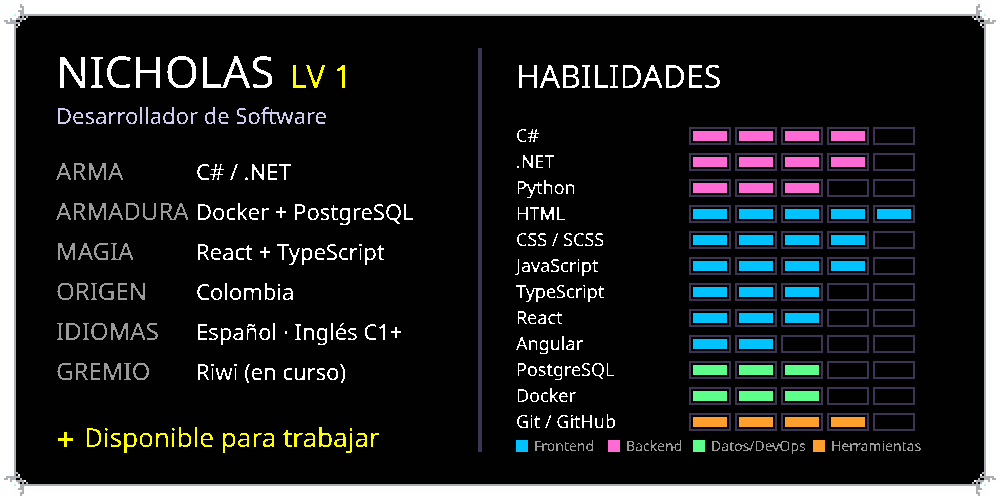
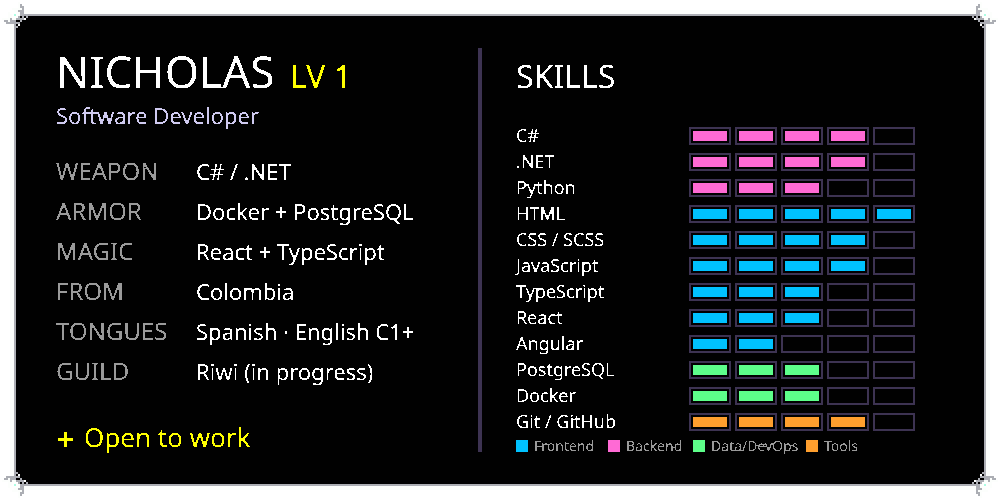

<!-- Cuando el portafolio esté en línea, descomenta esta línea:

-->

Soy desarrollador de software de Colombia. Empecé con HTML, CSS y JavaScript en CoderHouse haciendo una fan page de DELTARUNE (sí, desde ahí viene todo esto), y hoy trabajo sobre todo con **C# / .NET**, **PostgreSQL** y **Docker** en el backend, y **React** o **Angular** en el frontend. Me estoy formando en **Riwi** y busco un equipo donde seguir creciendo y aportar desde el primer día.

- ★ **Ahora mismo:** termino mi portafolio (React 19 + .NET 10) y una pasarela de pagos simulada, InfectionPay.
- ★ **Aprendiendo:** Clean Architecture, pruebas con xUnit y despliegues con Docker.
- ★ **Idiomas:** español nativo e inglés C1+. También me gusta traducir y localizar.
- ★ **Fuera del código:** escribo historias y universos alternos, y juego bastante (adivina a qué).
- ★ **Cómo trabajo:** código simple y ordenado (KISS), sistemas que puedan crecer y discusiones que me hagan mejorar.

   
  

| | Proyecto | De qué se trata | Stack |
|:-:|---|---|---|
| ♥ | **[Portafolio](https://github.com/nicholas-delarosa/portfolio)** | Mi portafolio con estética DELTARUNE: se maneja con teclado como un menú del juego, sincroniza mis repos de GitHub y tiene panel de administración. Español e inglés. | React 19 · TypeScript · .NET 10 · PostgreSQL · Docker · Caddy |
| ★ | **[InfectionSolutions](https://github.com/Esthercita-Factory/nicholas-delarosa-InfectionSolutions)** | Mi primer sistema full-stack: venta y distribución de materiales de construcción. Panel administrativo, API REST con JWT, carga desde Excel, recibos PDF y [portal de clientes](https://github.com/Esthercita-Factory/nicholas-delarosa-InfectionSolutions.Client). | .NET 10 · ASP.NET Core MVC · EF Core · PostgreSQL · Angular · Docker |
| ★ | **[InfectionPay](https://github.com/nicholas-delarosa/InfectionPay.Backend)** | Pasarela de pagos simulada: emite tarjetas ficticias y expone una API para que una tienda cobre como lo haría con Stripe en modo test. | .NET 10 · Clean Architecture · EF Core · PostgreSQL · Swagger |
| ★ | **[UniMarket](https://github.com/nicholas-delarosa/uni-market)** · [demo](https://unimarket-omega.vercel.app) | Marketplace universitario para estudiantes emprendedores. Proyecto integrador de Riwi; ahí fui el desarrollador frontend. | Node.js · Express · PostgreSQL · SCSS · JavaScript |
| ★ | **[EduAgent](https://github.com/nicholas-delarosa/EduAgent)** | Agente pedagógico local con Ollama: genera planes de clase, sílabos y mallas curriculares y los exporta a PDF o DOCX. | Python · Ollama |
| ★ | **[El Progreso](https://github.com/Esthercita-Factory/nicholas-delarosa-ElProgreso)** | App de consola para el cajero de una cooperativa de ahorro: socios, depósitos, retiros, reportes y conversión COP/USD asíncrona. | C# · .NET 10 |
| ★ | **[Quizzes 3° de primaria](https://github.com/nicholas-delarosa/esp32-quizzes)** | SPA con quizzes de cuatro materias; cada intento elige 10 preguntas al azar y mezcla las respuestas. | JavaScript (ES Modules) · HTML · CSS |
| ★ | **[DELTARUNE Fan Page](https://github.com/nicholas-delarosa/deltarune-final)** · [demo](https://deltarune-final.vercel.app) | Donde empezó todo: proyecto final del curso de Desarrollo Web en CoderHouse. | HTML · SASS · JavaScript |

| | Cuándo | Qué | Dónde |
|:-:|---|---|---|
| ★ | oct 2026 | Primer sistema full-stack: InfectionSolutions | Esthercita Factory |
| ★ | mar 2026 – hoy | Formación en Desarrollo de Software (Python, bases de datos, C# / .NET, Angular, metodologías ágiles) | Riwi |
| ★ | jun – sep 2025 | React JS: componentes, hooks y rutas. Proyecto final: tienda online | CoderHouse |
| ★ | mar – may 2025 | Desarrollo Web: HTML, CSS, SASS y JavaScript. Proyecto final: DELTARUNE Fan Page | CoderHouse |

  
  

  

  
  
  

* O cópialos a mano: <code>nicholasandresdelarosarivera@hotmail.com</code> · <code>+57 304 428 3435</code>

Estoy abierto a ofertas de trabajo, proyectos de código creativo, colaboraciones de traducción o cualquier cosa con sabor a videojuego. Escríbeme sin miedo.

> **Lema:** `I CAN, YOU CAN, WE CAN DO ANYTHING!`

I'm a software developer from Colombia. I started out with HTML, CSS and JavaScript at CoderHouse by building a DELTARUNE fan page (yes, that's where all of this comes from), and these days I mostly work with **C# / .NET**, **PostgreSQL** and **Docker** on the backend, and **React** or **Angular** on the frontend. I'm training at **Riwi** and looking for a team where I can keep growing and contribute from day one.

- ★ **Right now:** finishing my portfolio (React 19 + .NET 10) and a mock payment gateway, InfectionPay.
- ★ **Learning:** Clean Architecture, testing with xUnit and shipping with Docker.
- ★ **Languages:** native Spanish and C1+ English. I also enjoy translation and localization.
- ★ **Away from the keyboard:** I write stories and alternate universes, and I play a lot of games (guess which one).
- ★ **How I work:** simple, tidy code (KISS), systems that can grow, and discussions that make me better.

   
  

| | Project | What it is | Stack |
|:-:|---|---|---|
| ♥ | **[Portfolio](https://github.com/nicholas-delarosa/portfolio)** | My DELTARUNE-styled portfolio: you navigate it with the keyboard like a game menu, it syncs my GitHub repos and has an admin panel. Spanish and English. | React 19 · TypeScript · .NET 10 · PostgreSQL · Docker · Caddy |
| ★ | **[InfectionSolutions](https://github.com/Esthercita-Factory/nicholas-delarosa-InfectionSolutions)** | My first full-stack system: sales and distribution of construction materials. Admin panel, REST API with JWT, Excel import, PDF receipts and a [customer portal](https://github.com/Esthercita-Factory/nicholas-delarosa-InfectionSolutions.Client). | .NET 10 · ASP.NET Core MVC · EF Core · PostgreSQL · Angular · Docker |
| ★ | **[InfectionPay](https://github.com/nicholas-delarosa/InfectionPay.Backend)** | Mock payment gateway: issues fake cards and exposes an API so a store can charge them the way it would with Stripe in test mode. | .NET 10 · Clean Architecture · EF Core · PostgreSQL · Swagger |
| ★ | **[UniMarket](https://github.com/nicholas-delarosa/uni-market)** · [demo](https://unimarket-omega.vercel.app) | University marketplace for student entrepreneurs. Riwi capstone project, where I was the frontend developer. | Node.js · Express · PostgreSQL · SCSS · JavaScript |
| ★ | **[EduAgent](https://github.com/nicholas-delarosa/EduAgent)** | Local teaching assistant agent on Ollama: generates lesson plans, syllabi and curricula and exports them to PDF or DOCX. | Python · Ollama |
| ★ | **[El Progreso](https://github.com/Esthercita-Factory/nicholas-delarosa-ElProgreso)** | Console app for a savings cooperative teller: members, deposits, withdrawals, reports and async COP/USD conversion. | C# · .NET 10 |
| ★ | **[3rd grade quizzes](https://github.com/nicholas-delarosa/esp32-quizzes)** | SPA with quizzes for four school subjects; each attempt picks 10 random questions and shuffles the answers. | JavaScript (ES Modules) · HTML · CSS |
| ★ | **[DELTARUNE Fan Page](https://github.com/nicholas-delarosa/deltarune-final)** · [demo](https://deltarune-final.vercel.app) | Where it all began: final project of the Web Development course at CoderHouse. | HTML · SASS · JavaScript |

| | When | What | Where |
|:-:|---|---|---|
| ★ | Oct 2026 | First full-stack system: InfectionSolutions | Esthercita Factory |
| ★ | Mar 2026 – now | Software Development Program (Python, databases, C# / .NET, Angular, agile teamwork) | Riwi |
| ★ | Jun – Sep 2025 | React JS: components, hooks and routing. Final project: online store | CoderHouse |
| ★ | Mar – May 2025 | Web Development: HTML, CSS, SASS and JavaScript. Final project: DELTARUNE Fan Page | CoderHouse |

  
  

  

  
  
  

* Or copy them by hand: <code>nicholasandresdelarosarivera@hotmail.com</code> · <code>+57 304 428 3435</code>

I'm open to job offers, creative coding projects, translation work or anything with a video game flavor. Feel free to reach out.

> **Motto:** `I CAN, YOU CAN, WE CAN DO ANYTHING!`

